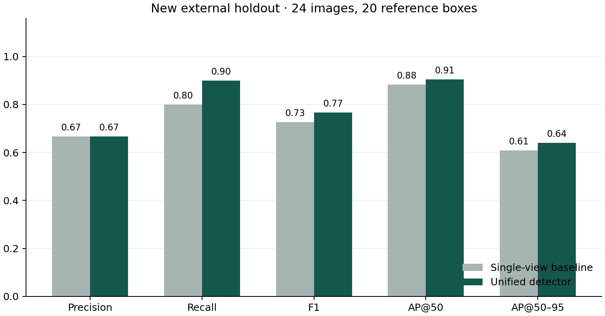

# Unified syringe detector optimization

## Experimental design

All image paths use the same detection pipeline and operating point. The historical Fil rouge threshold and hash-based routing were removed from the application. The original frozen model, validation, and external results are preserved as historical artifacts.

### Candidate design

- Compare the original view, a horizontal reflection, and two 90° rotations with the original view always included. Restore boxes to source coordinates before merging. Compare maximum-score suppression against voting and weighted coordinates, and compare suppression overlap 0.60 and 0.75.
- Train seven supervised heads locally on proposals from the 74-image development session, with 5,145 original proposals or 10,063 original plus augmented proposals. A proposal is positive when it overlaps a draft box at IoU ≥0.50. Compare logistic regression, extra randomized trees, and histogram gradient boosting. Inputs are logit confidence, box geometry, coarse gradient orientation and patch saturation/value statistics, depending on the run.
- Compare geometry versus appearance, mirrored brightness augmentation, and inverse proposal frequency by acquisition burst. Every fit balances positive and negative proposal weights. No validation or test proposals enter these fits. Candidate regressions use the same boxes and frozen Grounding DINO Tiny backbone.
- On the validation sample of 19 Commons images, compare blends of learned and base scores. Compare the best ranked heads from two distinct model families as an ensemble. Total candidate count is 104, including 29 view-only configurations. Choose the global software operating point by validation F1, then prefer higher recall, AP@50–95, and lower model complexity in ties. Scores are not calibrated probabilities.
- The new external holdout contains 24 manually selected Wikimedia photographs from 24 known authors, 20 syringe boxes and seven negative scenes. Annotate and checksum those files before model scoring. Separate the new holdout from training, validation and historical external test through source, author, group, exact hash and difference hash checks. Its labels are a single-pass visual reference. Open-vocabulary pretraining overlap cannot be excluded.
- Score the same locked release and historic single-view detector on the new holdout. The previously inspected external test is explicitly a historical regression. The Fil rouge source is explicitly a development regression. The number of tried configurations relative to the validation sample makes fresh holdout evidence essential.

### Selected configuration and validation

The selected configuration takes the original view and a 270° rotation and combines candidates by maximum score with suppression at IoU 0.60. It blends the base ranking with a mean of appearance-based logistic regression and geometry-based extra trees trained with augmentation and burst weights. Weights and the system operating cutoff are fixed by the release manifest.

| Validation method | Precision | Recall | F1 | AP@50 | AP@50–95 |
| --- | ---: | ---: | ---: | ---: | ---: |
| Historical single view | 0.800 | 0.800 | 0.800 | 0.797 | 0.543 |
| Two views without learned heads | 0.813 | 0.867 | 0.839 | 0.818 | 0.531 |
| Two views with the learned ensemble | 0.813 | 0.867 | 0.839 | 0.826 | 0.539 |

The learned ensemble improved ranked average precision over the view-only candidate with the same operating-point precision and recall. AP@50–95 on validation remained slightly below the historical single view. The full ledger includes candidates where augmentation, burst balancing or a more complex estimator gave no improvement. [Training comparisons](../artifacts/detector_training_trials.json) · [View comparison](../artifacts/v2_search.json) · [Release configuration](../artifacts/detector_release.json)

## Fresh external holdout results

| Frozen method | TP | FP | FN | Precision | Recall | F1 | AP@50 | AP@50–95 | Exact counts |
| --- | ---: | ---: | ---: | ---: | ---: | ---: | ---: | ---: | ---: |
| Historical single view | 16 | 8 | 4 | 0.667 | 0.800 | 0.727 | 0.884 | 0.608 | 15/24 |
| Two views without learned heads | 18 | 11 | 2 | 0.621 | 0.900 | 0.735 | 0.905 | 0.635 | 17/24 |
| Unified detector with learned ensemble | 18 | 9 | 2 | 0.667 | 0.900 | 0.766 | 0.905 | 0.639 | 19/24 |

The second view recovered two reference objects at the cost of three additional false positives. The trained heads removed two false positives while retaining the same object recall. The final comparison with the original detector has equal precision, two more correct detections and one more false positive. It correctly returned no accepted objects in 3/7 negative scenes, compared with 2/7 for the original. Remaining errors include false detections on ampoules and a microdispenser, and unmatched boxes in a blurred scene and a scene with partial occlusion.

The paired 95% author-bootstrap interval for the F1 difference is approximately −0.086 to +0.192. The point improvement is measured on this set, and the interval is too wide to establish a general gain. Median proposal time was 8.48 seconds per image under the concurrent CPU workload used in this evaluation. This measures both detector views including preprocessing, and excludes head scoring and OCR. Latency increases with the extra view. No GPU rental or user-data transfer was needed. [Holdout error records and metrics](../artifacts/optimized_holdout.json)



## Regression checks

- **Fil rouge development session.** The unified detector matched 70/74 draft boxes with no false positives, compared with 54/74 for the historical global setting. The earlier collection-specific setting had 74/74. The unified detector missed IMG_3229, IMG_3235, IMG_3283, IMG_3318. This comparison uses oriented lossless derivatives of the original photographs. The original file digests were rechecked, and the release also ran successfully on a real HEIC through both the local API and Chromium. [Development results](../artifacts/optimized_train.json)
- **Previously inspected Open Images set.** The historical detector matched 10/15 boxes with F1 0.800. The unified detector matched 9/15 with F1 0.750. Both had zero false positives on these ten images. That small-sample regression remains visible alongside the gains on the new external holdout. The original test report and predictions are preserved. [Historical regression results](../artifacts/optimized_test.json)

## Reproduction

Make a fresh workspace with the original prepared data, pinned weights, draft training annotations, and public reference manifests. Keep the delivered release files as audit records. In the fresh workspace materialize the original training and augmented proposal caches with `python -m medsyringe.detectors dino train` and the same command with `--variant augmented`. Then use the following commands in the locked Python environment:

```bash
HF_HUB_OFFLINE=1 uv run --locked python -m scripts.refine_detector select
OMP_NUM_THREADS=3 OPENBLAS_NUM_THREADS=3 HF_HUB_OFFLINE=1 uv run --locked python -m scripts.optimize_detector select
HF_HUB_OFFLINE=1 uv run --locked python -m scripts.optimize_detector train
HF_HUB_OFFLINE=1 uv run --locked python -m scripts.optimize_detector holdout
HF_HUB_OFFLINE=1 uv run --locked python -m scripts.optimize_detector test
```

The fresh holdout materializer reads the fixed download URLs and validates the downloaded file digests before inference. The local trained-head archives are in `data/trained_heads`. The two deployed estimators are bundled in `artifacts/proposal_heads.joblib`, with a verified digest pinned by the release. Restore checkpoints only from the trusted project workspace. All inference runs offline after fetching the pinned assets.

## Next training experiments

1. Acquire independently labeled crowded scenes and hard negatives first. The current single-session corpus contains no genuine negative frames or crowded scenes. The head learns negative proposals within positive images, which provides narrower supervision.
2. Add rotation, glare, blur, crop and box-jitter ablations one at a time using the same held groups. Evaluate scale-aware tiling with overlap on small or occluded syringes. Check whether boxes from tile edges duplicate whole-frame objects.
3. Compare multi-view selection against a fine-tuned lightweight detector using diverse real group-split supervision. A separately evaluated quantized deployment may recover latency if learned features are needed. Backbone fine-tuning was outside this comparison. Its potential benefit cannot be established by repeatedly tuning on the supplied session.
4. Use additional holdout groups and independent second annotations to estimate operating uncertainty before claiming improvements beyond this external sample.
