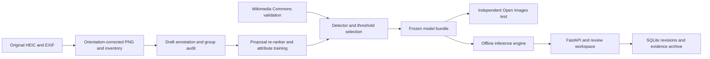

# Engineering and reproduction

## Components and data flow



| Component | Interface | Materialized outputs |
| --- | --- | --- |
| `data.py` | `audit`, `validation`, `test`, `verify`, `coco` | Image inventory, eligibility, split manifests, COCO, leakage and hash audit |
| `detectors.py` | `Grounder.propose(PIL.Image)` | Ranked, normalized proposals with scores; hashed per-image inference cache |
| `evaluate.py` | `validation`, `test` | Re-ranker checkpoints, model comparison, frozen selection, test metrics and boxes |
| `attributes.py` | `describe`, `read_inscriptions` | Experimental visual attribute suggestions with rejection; crop-local OCR evidence |
| `inference.py`, `production.py`, `pipeline.py` | Frozen baseline, detector release and current inference entry point | Scene observation, ranked evidence, the crop verifier and stroke-guided OCR |
| `scene.py`, `app.py`, `web/` | Loopback FastAPI and browser workspace | Versioned reviews, approved COCO, count discrepancies, comparisons and export |
| `scripts/` | Diagnostics, figures and smoke tests | Measured diagnostics, test overlays and figures |

The draft reference uses boxes in visual, EXIF-corrected image coordinates. Export converts normalized xyxy to COCO pixel xywh and validates extents. All original photos are grouped together. A frame-level resample or burst holdout is used only for the explicitly labeled attribute diagnostic. Source identity and time are recorded without GPS fields. Documents and JSON artifacts are versionable in Git. The large model and pixel files are local and ignored by Git. No system account or external data service participates in normal inference.

## Re-run in a fresh experiment directory

Run from the repository root. First install dependencies and fetch model assets as in the README. Use a new directory for each experiment and keep the source images outside the workspace output.

```bash
repo="$(pwd)"
experiment="$(mktemp -d -t medsyringe-research.XXXXXXXX)"
source_images="/path/to/Images"

mkdir -p "$experiment/artifacts" "$experiment/data"
ln -s "$repo/data/models" "$experiment/data/models"
cp "$repo/uv.lock" "$experiment/"
cp "$repo/artifacts/annotations.json" "$repo/artifacts/commons_annotations.json" "$experiment/artifacts/"

uv run --locked python -m medsyringe.data audit --root "$experiment" --source "$source_images"
uv run --locked python -m scripts.source_profiles --root "$experiment" --source "$source_images"
uv run --locked python -m medsyringe.data validation --root "$experiment"
HF_HUB_OFFLINE=1 uv run --locked python -m medsyringe.attributes --root "$experiment"
HF_HUB_OFFLINE=1 uv run --locked python -m medsyringe.evaluate validation --root "$experiment"

# Only run the following after freeze.json exists.
uv run --locked python -m medsyringe.data test --root "$experiment"
uv run --locked python -m medsyringe.data verify --root "$experiment" --source "$source_images"
uv run --locked python -m medsyringe.data coco --root "$experiment"
HF_HUB_OFFLINE=1 uv run --locked python -m medsyringe.evaluate test --root "$experiment"
```

Validation materialization downloads image bytes from the saved Commons source URLs and verifies the exact file hashes. Use an existing trusted copy of the matching snapshot under `$experiment/data/commons/` if a link is temporarily unavailable. The Open Images sources and candidate exclusions are retained in the test manifest. Use the same inputs or report the resulting new dataset version.

The selection runner refuses to overwrite a freeze. The test runner verifies code, dependency lock, validation manifest, results, and model bundle hashes. Training uses seed 607, fixed source ordering, scikit-learn logistic regression, hue/edge descriptors, and deterministic preprocessing. The two re-ranker JSON files contain the fitted feature means, scales, coefficients and intercepts. The selected raw model bundle has no experimental classification head in the detection step. The CPU traces include time spent building backbone proposals, which dominates fitting. Latency will vary with machine load.

For the delivered run, re-run tests and reports from the repository root.

```bash
uv run --locked python -m pytest -q
uv run --locked python -m scripts.audit_summary
uv run --locked python -m scripts.ocr_diagnostic
uv run --locked python -m scripts.compute_benchmark
uv run --locked python -m scripts.robustness
uv run --locked python -m scripts.report_figures
uv run --locked python -m scripts.provenance
```

For a reproducibility check of the delivered test evaluation, run `python -m medsyringe.evaluate test` in the locked environment using the prepared holdout. It checks the frozen configuration before scoring. The run ledger records proposal cache hashes, elapsed sums, source code and artifact hashes. Rebuild the presentation with `typst compile --root . docs/presentation.typ docs/presentation.pdf`.

The real-asset smoke checks are available as `python -m scripts.smoke_app path/to/IMG_3228.HEIC` and `uv run --locked --with playwright==1.65.2 python -m scripts.browser_smoke path/to/IMG_3228.HEIC`. Install Chromium locally or set `MEDSYRINGE_CHROMIUM` to its executable path. The API smokes use temporary workspaces and do not alter user review histories.

## Unified detection configuration

The release uses one detector configuration for all source images. The application and `python -m medsyringe.pipeline` verify the base backbone, the proposal heads and the release evidence. A guarded crop verifier can route weak uncorroborated detections to review. When the existing OCR abstains on capacity, a separate local worker can verify printed scale evidence. Content hashes identify active components in each observation. The earlier `medsyringe.production` and `medsyringe.inference` entry points reproduce the corresponding frozen pipelines. [Crop verifier and Intel runtime](improvement_regression.md) · [Stroke-guided OCR](graduation_piston_recovery.md)

## Independent human review

1. Prepare the source and open **Review draft** in the application.
2. Inspect the source and original draft. Prioritize flagged clipped and ambiguous cases. Use the standard reviewed bounding-box convention. Leave uncertain visual attributes unknown.
3. Record the reviewer name and the basis for corrections. Mark the annotation approved only once the full image has been checked.
4. Export approved COCO and retain its accompanying image snapshot, the SQLite workspace, and the source inventory. The original draft and successive corrected revisions remain available in the report.
5. Keep approved annotations and future data versions separately from the delivered freeze. Build a new explicitly grouped manifest and run validation before independent testing.

The original source contains no independent reviewer approvals. The application distinguishes reviewed annotations from draft proposals and only includes approved revisions in its COCO review export. The packaged observation image is a local JPEG preview aligned to normalized boxes. The original embedded color profile travels with uploaded previews. Source profile sidecars restore the original display rendering for prepared draft previews without changing the frozen PNG bytes. The original file digest identifies the high-resolution source, which remains with the operator.

## Rights and portability

Repository code uses its Apache-2.0 license. The pinned Grounding DINO Tiny and OWLv2 model cards list Apache-2.0. Model files are cached separately with their upstream references. Wikimedia Commons attribution and per-image licenses appear in `commons_annotations.json`. Open Images attribution and CC BY 2.0 references appear in `test_manifest.json`. The collection supplied with the assignment has no explicit redistribution grant in the provided materials. Its pixels are excluded from the tracked artifacts and are never uploaded. The reference-only overlays are rendered locally from attributable public test sources. RF-DETR, YOLO26, SAM 3.1 and Roboflow were researched through primary sources. The shipped system uses none of their services.

Runtime was exercised on an Intel Core Ultra 7 258V with Intel Arc graphics, 30 GiB of RAM and 117 GiB of free space at audit time. We selected CPU wheels and performed all experiment execution on CPU. Although Arc was present through Vulkan and Level Zero, GPU execution parity was outside this run. No cloud compute, paid assets or uploaded source pixels were required.
