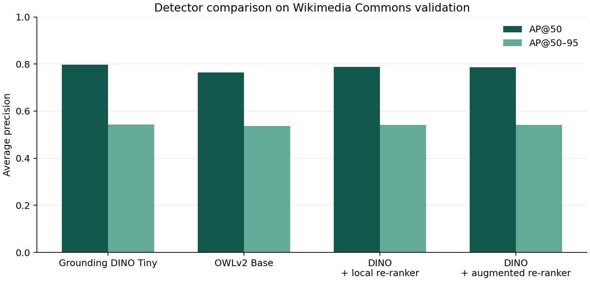
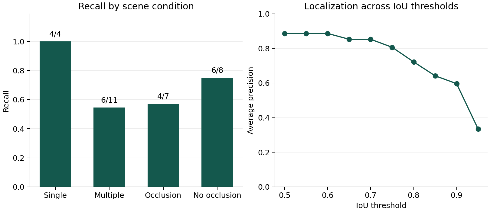
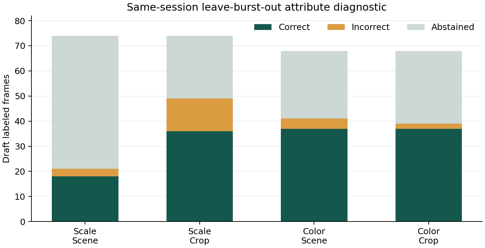

# MedSyringe Vision

The latest detection study evaluates the released hybrid and new candidates on additional photographer-disjoint cohorts. It includes matched training comparisons, visual reference corrections and the reserved error audit. [Detection across acquisition domains](detection_generalization.md)

**A local evaluation of syringe localization, visual description, and human verification**

Master's project technical report · 20 November 2026

## Abstract

We studied syringe scene understanding from 75 smartphone photos. The photos form a single provenance group with repeated objects and acquisitions, which precludes an independent split within the supplied collection. We used 74 unique images for development, an external Wikimedia Commons validation sample for model selection, and an untouched ten-image Open Images holdout for localization. We compared Grounding DINO Tiny, OWLv2 Base, and two locally trained proposal re-rankers. The selected Grounding DINO produced 1.000 observed precision, 0.667 recall and 0.747 AP averaged from IoU 0.50 to 0.95. It missed all five reference boxes in two multi-object scenes. The local application gives access to source evidence, below-threshold candidates, reversible review history and reference checks. Crop-based scale and color classifiers and an OCR candidate extractor were evaluated in development only. These results support further study of a review workflow and expose limitations in crowded scenes, attribute recognition and unknown-case evaluation.

## 1. Research questions

1. Can a compact text-grounded detector locate syringes outside the supplied acquisition session?
2. Does a lightweight supervised head trained on local annotations improve spatially accurate ranking over the frozen detector? Does adding brightness and orientation variation help?
3. Does cropping to a syringe improve type and color suggestions when abstentions count against complete coverage?
4. Can the pipeline expose enough evidence to audit an incorrect or uncertain result and retain a subsequently corrected version?

The project defines *type* as visible printed scale family, with 20-scale and 60-scale patterns. The barrel-color label refers to the apparent region seen through the barrel. Neither label establishes device capacity, material identity, contents or an invisible medical property.

## 2. Data and reference construction

The source contains 75 HEIC files captured in 18 minutes 4 seconds by one iPhone 17 Pro Max. All 75 source SHA-256 digests matched after processing. Orientation correction yielded 73 unique portrait rasters of 3024 × 4032 and one landscape raster of 4032 × 3024. IMG_3215(1) was byte-identical to IMG_3215. The only additional pair at a 64-bit difference-hash Hamming distance of four or less was IMG_3316 and IMG_3317. This conservative hash detects some close frames while repeated objects can still appear in different poses or lighting. Visual inspection showed contiguous bursts and probable reuse of the same objects. The entire collection therefore occupies one acquisition group.

We drafted 74 single-object boxes on oriented contact sheets, inspected larger marking examples, and flagged uncertain visible extent, clipping and ambiguous colors. The 58 20-scale and 16 60-scale labels are visual development labels. Thirty-two examples had amber-brown appearance, 36 orange and six ambiguous under changing illumination. Most images contain a hand and a dark background. The source contains no verified negative, simultaneous-instance, reference-inventory or tracked-video scenes. The labels await independent human review. A comparison against the top DINO proposal yielded median IoU 0.902 and 66/74 at IoU ≥0.75. It indicates which examples might benefit from assisted review. It provides no annotation-quality estimate against an independent reviewer and no time-savings measurement.

No Open Images validation file linked from the V7 release contained a Syringe box or human-verified class row. We used 19 curated Commons photos with per-file attribution and draft visual boxes for selection, with 15 boxes in 14 positive scenes, five reviewed negatives and one two-object scene. The independent sample comes from Open Images official test annotations. It contains eight positive scenes with 15 objects and two verified negative scenes, with ten distinct author groups. Two candidate images were excluded by the predefined group/depiction/inside rule. The frozen threshold was written before test pixels were fetched. Tested cross-partition duplicate, group, author, URL and difference-hash checks found no overlap. Broad pretraining and known perceptual-hash limits mean the study cannot establish absolute separation from every upstream training source.

## 3. Methods

### Detection and controlled training comparison

Grounding DINO Tiny used a syringe text prompt and an aspect-preserving 480-pixel short edge with an 800-pixel long-edge limit. OWLv2 Base used its 960-pixel processor and a photo-of-a-syringe text prompt. Both ran locally through PyTorch and Transformers with pinned safetensors. Normalized proposals used a minimum raw score of 0.02, with up to 100 candidates and shared greedy NMS at IoU 0.60. Inputs and checkpoint files are checksum-bound.

We trained class-balanced logistic proposal classifiers on the logit-transformed raw score, log normalized box area, and absolute log aspect ratio. Proposals matching a draft box at IoU ≥0.50 were positive training examples. The learned score was averaged with the original backbone score. The ablation used the same head and fitting procedure plus one mirrored and brightness-perturbed view of each training image. Respective fitting inputs were 5,145 and 10,063 proposals, with 1,113 and 2,164 positives. Fitting took 0.068 and 0.108 seconds on this run. Backbone feature extraction is much more expensive. These are low-capacity fits on fixed features, so the detector backbone has no training or convergence curves in this study.

We selected the highest validation AP over IoU 0.50:0.05:0.95. Each operating threshold was chosen by validation F1 at IoU 0.50, with ties resolved in favor of precision and then higher threshold. Matching is one-to-one and score-ordered. AP is the mean interpolated precision over 101 recall points. This is a custom one-class evaluation with a COCO-style AP definition. Its scores should be compared only under this reference and proposal policy. The operating score is uncalibrated.

### Visual attributes and OCR

The attribute heads use robust centroids over a compact spatial/edge descriptor for scale and hue/saturation/brightness statistics for color. Distance and margin rules reject weak matches. Whole-scene and object-crop comparisons refit the heads for each held-out burst in the supplied session. Repeated physical instruments may occur on both sides of these development comparisons. The fixed crop reference gives an optimistic diagnostic for upstream localization and leaves no independent attribute accuracy estimate.

Tesseract reads optional grayscale object crops at four right-angle orientations and returns candidate digit or unit tokens with positions. A known-legible probe used nine enlarged same-session examples and one visually read reference token per image. The app allows human transcription and leaves capacity and volume fields empty. A graduation number alone cannot disambiguate a tick, a maximum scale marking or a physical volume.

## 4. Results

### Validation and model selection

| Detector | Precision | Recall | F1 | AP@50 | AP@50–95 | Backbone weights |
| --- | ---: | ---: | ---: | ---: | ---: | ---: |
| Grounding DINO Tiny | 0.800 | 0.800 | 0.800 | 0.797 | **0.543** | 689 MB |
| OWLv2 Base | 0.750 | 0.800 | 0.774 | 0.764 | 0.536 | 620 MB |
| DINO + local re-ranker | 0.800 | 0.800 | 0.800 | 0.787 | 0.542 | 689 MB + JSON head |
| DINO + augmented re-ranker | 0.800 | 0.800 | 0.800 | 0.787 | 0.541 | 689 MB + JSON head |

Grounding DINO had the highest validation AP, with a small margin and limited sample size. The re-ranker and augmentation offered no measured gain under this protocol. OWLv2 was a close alternative on AP@50–95. Supervised adaptation from repetitive single-syringe frames may add an acquisition prior with little value on varied images.

### Independent test

At the frozen score cutoff of **0.539851**, the detector produced **10 TP, 0 FP and 5 FN**. Precision was **1.000**, recall **0.667**, F1 **0.800**, AP@50 **0.886**, and AP@50–95 **0.747**. Scene counts were exact on **8/10** images. Both marked negative images returned zero accepted objects. At the image-level presence task, the resulting counts were six true positives, two false negatives, two true negatives and zero false positives. Both AP and operating precision are specific to the dataset and label convention. In particular, zero observed false positives across ten predictions does not establish a population precision of 100%.

| Slice | Scenes | Annotated objects | Detected matches | Exact scene counts |
| --- | ---: | ---: | ---: | ---: |
| Single object | 4 | 4 | 4 | 4 |
| Multiple objects | 4 | 11 | 6 | 2 |
| At least one reference occlusion | 2 | 7 | 4 | 1 |
| Positive with no reference occlusion | 6 | 8 | 6 | 5 |
| Verified negatives | 2 | 0 | 0 | 2 |

The 10,000-draw author-group bootstrap recall interval was **0.286–1.000**. With no false positives in the observed groups, the empirical precision bootstrap is degenerate and supplies no useful lower bound on generalization. The numerical target of ≥95% recall was missed. The precision point estimate exceeds the proposed target, but the sample is inadequate to establish it.

Two photos account for all five misses. In the photo with two nearly parallel syringes, spatially matching proposals scored 0.442 and 0.429 despite IoUs of 0.974 and 0.973. In the photo with three syringes interspersed with a bottle and blister packaging, spatially matching proposals scored 0.292–0.361. The five matches were inspected after the freeze, and the threshold was left unchanged. The failure is primarily low confidence in these scenes, although some proposals overlap more than one reference. Four scenes had only below-threshold proposals, including the two negative scenes. Proposal presence alone does not discriminate an uncertain positive from an empty scene.

One test reference is titled “Drying tube”: its visual appearance suggests a possible disagreement between the Open Images category and the project definition. We retain the deterministic upstream reference in the headline result and flag the ambiguity. Removing its matched instance would yield 9/14 recall in a post-hoc sensitivity calculation. The test manifest provides per-image attribution. Local overlays generated from that manifest show accepted boxes in green and upstream boxes in amber.

### Controlled acquisition degradation

These post-freeze tests reuse the 19 validation scenes and their same draft boxes. A brightness multiplier of 0.5 and Gaussian blur radius of four source pixels change the images while preserving scene membership. The original operating cutoff is retained.

| Validation condition | TP | FP | FN | Recall | F1 | AP@50–95 |
| --- | ---: | ---: | ---: | ---: | ---: | ---: |
| Original | 12 | 3 | 3 | 0.800 | 0.800 | 0.543 |
| Half brightness | 10 | 2 | 5 | 0.667 | 0.741 | 0.572 |
| Gaussian blur | 9 | 1 | 6 | 0.600 | 0.720 | 0.543 |

Both perturbations reduced operating recall. AP remained comparable or improved because confidence-ranked localization and performance at a fixed operating point measure different properties. These controlled effects are conditional on the selected validation photos. [Perturbation outputs](../artifacts/development_robustness.json)

### Attribute and OCR diagnostics

| Attribute / input | Eligible draft labels | Answered | Correct | Accuracy among answers | Correct among eligible |
| --- | ---: | ---: | ---: | ---: | ---: |
| Visual scale, whole scene | 74 | 21 | 18 | 85.7% | 24.3% |
| Visual scale, crop | 74 | 49 | 36 | 73.5% | 48.6% |
| Barrel color, whole scene | 68 | 41 | 37 | 90.2% | 54.4% |
| Barrel color, crop | 68 | 39 | 37 | 94.9% | 54.4% |

Cropping doubled the count of correct scale suggestions at the cost of a lower answer-conditional accuracy. Color cropping gave the same number of correct suggestions with fewer completed answers. These findings expose the difference between precision among answers and complete description coverage. The classifiers have no independently validated unknown-class sensitivity. The user can preserve an unknown field while retaining the detection and count evidence.

The targeted OCR token appeared among the candidates on **5/9** development frames. At least one candidate was returned on 8/9 frames, so a candidate is not evidence that the intended marking was recovered. This test did not establish full transcription accuracy, a measured volume or an uncertainty interval for volume. The raw OCR artifact preserves the candidate values and locations.

## 5. Runtime and engineering validation

The project ran locally on an Intel Core Ultra 7 258V using four PyTorch CPU threads. No CUDA device was identified. The test backbone warmed median was **3.06 seconds** and p95 **3.69 seconds** across nine timed images. The validation workloads originally overlapped and showed much higher timing under contention, so those timings are excluded from model-latency comparison. A separate serial benchmark uses the same three Commons photos per backbone with one warm-up and six measured batch-one runs. Grounding DINO median/p95 was 2.98/3.29 seconds, and OWLv2 median/p95 was 11.39/11.86 seconds. The serial timings include preprocessing, the backbone forward pass and NMS. They exclude decoding and OCR. [Controlled runtime data](../artifacts/serial_cpu_benchmark.json) Read-only preparation, box conversion, leakage checks, one-to-one metrics, inventory uncertainty and concurrent review handling have automated tests. Real HEIC inference, persisted review, and evidence export were exercised independently of unit tests, including a Chromium run at desktop and mobile viewport sizes. [API evidence](../artifacts/app_smoke.json) · [Browser evidence](../artifacts/browser_smoke.json)

The app tracks immutable initial observations and append-only human revisions. Users can verify each result against the source preview and correct boxes, visual attributes and inscriptions. Total inventory counts and attribute-specific differences are traceable to object IDs. Unknown attributes leave some discrepancy classes unresolved. Still-image comparison reports changes in counts rather than inferring which physical syringe moved. Full temporal identity requires validated video or an explicitly recorded observation sequence.

## 6. Validity and next experiments

The supplied data sample cannot establish generalization to the intended deployment domain. The originals carry Display P3 profiles. The frozen analysis uses decoded RGB values and provides no colorimetric calibration across devices. Profile sidecars retain the original rendering information for human review. Repeated objects, one capture device and visually similar groups limit evidence for generalization. The validation annotations have no independent adjudication. The external test is small and deliberately separated from local training. It tests generic localization in a different image and annotation domain. Baseline agreement with published targets for complete description, unknowns, and exact scene changes cannot be established from these data. Inventory logic is verifiable against synthetic and reviewed examples, while end-to-end inventory accuracy depends on detection and attribute accuracy.

A stronger study would hold out operators, acquisitions and physical units from purpose-built data. A blinded second reviewer should adjudicate draft boxes and explicitly label unknown attributes. Collect true negatives and difficult syringe-like distractors, crowded layouts and strong occlusion, plus lighting and pose extremes. Include different scale families, unmarked objects, out-of-scope items and balanced barrel appearances. Capture short sequences with reference tracks and a time-stamped ground-truth change log. Pre-register the operating cutoff, error budget, annotation human-time comparison and manual-inventory baseline before opening the audit group. Compare RF-DETR Nano fine-tuning and an Intel OpenVINO export against the frozen open-vocabulary detector once there are sufficiently independent examples.

## 7. Expanded capture and current release

The 177 additional Fil Rouge photographs comprise one acquisition session with one visible syringe per scene. Regression results show 177 exact counts and 172 instance matches at IoU 0.50 against the frozen draft references. This extends the operational coverage of the original study. Independent evaluation used a reviewed simulator corpus, photographer-disjoint public imagery, Open Images, difficult non-targets and a separate clinical instrument challenge. Controlled comparisons included D-FINE and RF-DETR transfer, additional annotation sources, visual-language prompting, and calibrated crop corroboration. [Expanded capture](expanded_report.md) · [Experimental comparisons and failures](detection_generalization.md)

The current detector includes a fixed SigLIP 2 appearance check. In a new 26-photo negative audit it reduced false boxes from seven to one, with 25 correct empty scenes. It preserved all previously matched instances across the positive controls. Earlier independent Commons precision rose from 50.0% to 76.9% and its F1 score from 57.1% to 71.4% at identical recall. The new 25-photo mixed cohort remains at 93.8% precision, 68.2% recall and 78.9% F1. A dual-detector rescue improved that cohort to 82.1% F1 and added a redundant box in one Fil Rouge photo, so its automatic behavior was excluded from the release. [Fixed precision evidence](../artifacts/detection_hillclimb/precision_negative_results.json) · [Instance and count regression](../artifacts/detection_hillclimb/precision_only_confirmation_audit.json)

The extended application uses local OCR of visible inscriptions, evidence-based capacity extraction, apparent fill estimates, and liquid lightness. Opacity needs an equivalent clear-barrel reference for the documented method. Native-resolution evidence, immutable model proposals and review revisions can be exported from an offline browser session. [Fill and uncertainty](fill_measurement.md) · [Graduation OCR](graduation_piston_recovery.md) · [Runtime reproduction](local_runtime_bundle.md)

## References and artifacts

- Project specification, sections 01–06. Project fil rouge M1 MIAS, 20 November 2026.
- Liu et al., *Grounding DINO: Marrying DINO with Grounded Pre-Training for Open-Set Object Detection*. [Paper](https://arxiv.org/abs/2303.05499) · [Pinned model family](https://huggingface.co/IDEA-Research/grounding-dino-tiny)
- Minderer et al., *Scaling Open-Vocabulary Object Detection*. [Paper](https://arxiv.org/abs/2306.09683) · [Model family](https://huggingface.co/google/owlv2-base-patch16)
- Google Research, Open Images. [Release files and format](https://storage.googleapis.com/openimages/web/download_v7.html) · [External test manifest](../artifacts/test_manifest.json)
- [Source audit and class distribution](../artifacts/dataset_summary.json) · [Validation results](../artifacts/validation_results.json) · [Freeze](../artifacts/freeze.json) · [Independent test metrics](../artifacts/test_results.json) · [Error cases and bootstrap](../artifacts/error_analysis.json)
- [Proposal and environment trace](../artifacts/cache_provenance.json) · [Annotation protocol](protocol.md) · [Model, tool and license review](research.md) · [Operational instructions](engineering.md)
