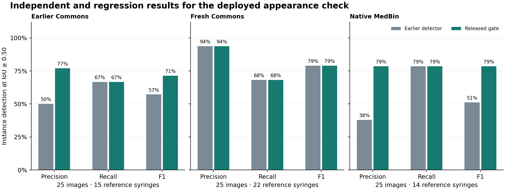
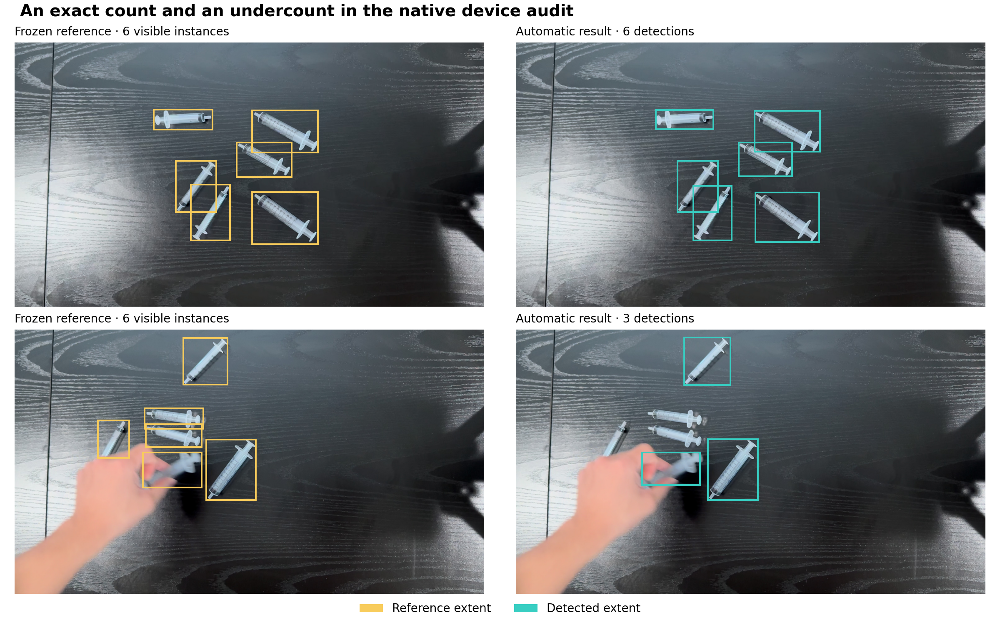
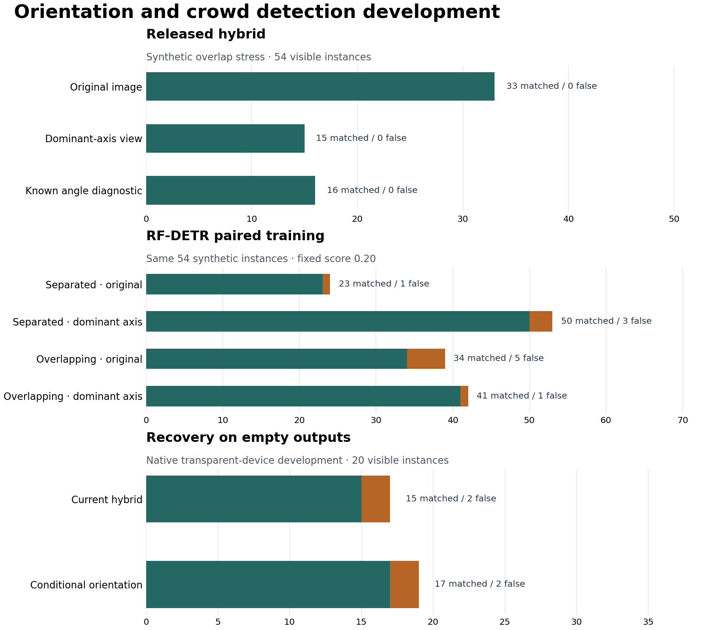

# Syringe detection across acquisition domains

The objective is to improve automatic detection in new photographs while preserving each previously correct localization. A localization is correct when one prediction matches one visible-instance reference at intersection over union (IoU) of at least 0.50. The automatic operating point is selected by the study and is fixed for the user. Object counts and box localization are evaluated separately. An image can have the correct count with an imprecise box.

## Evidence boundaries

| Cohort | Role in this study | Boundary |
| --- | --- | --- |
| 177 expanded Fil Rouge JPEGs | Same-session regression | All images are positive. Unknown reuse of physical specimens and one acquisition prevent an independent estimate of generalization. Original rasters are treated as read-only. |
| Zenodo simulated phlebotomy | Fit and development | 190 fit frames have 138 labeled boxes, 66 empty frames and 34 filename groups. Forty development frames have 28 boxes, 14 empty frames and three filename groups. Close views recurring across filename groups restrict the interpretation to this simulation. |
| Commons public development | Selection | Eleven scenes by 11 photographers, with nine visible syringes in six scenes and five negatives. |
| Commons public audit | Reserved | Twenty-five scenes by 25 photographers, with 15 visible syringes in 13 scenes and 12 negatives. The list and boxes were reviewed without predictions, and hashed before scoring. |
| Dental-instrument challenge | Reserved stress test | Twenty frames with an aspirating dental syringe in 12 and structurally similar instruments in eight. A single publisher setup and probably recurring tools make this a controlled challenge. |
| Previous public reserve | Historical regression | Earlier study exposure limits this cohort to regression evidence. |

The corpus builders record source URLs and groups, attribution, license, byte hashes, and perceptual hashes. Commons screening compares rotations and reflections. The Zenodo capture includes different angles at a repeating clinical simulator. Its available previously unused groups are negative and visually linked to known scenes. The primary external scope is the new public photograph cohort. Original web or foundation-model pretraining exposure is unknown. This challenge uses deliberate enrichment for difficult scenes, so precision is conditional on the mix of positives and lookalikes. [Corpus investigation](../../datasets/detection_corpus_research.md) · [Commons protocol](detection_public_benchmark.md) · [Zenodo fit and development manifest](../../../artifacts/detection_hillclimb/phlebotomy.json)

A local crop- and rotation-aware lineage screen covered 598 distinct images and checked 8,493 shortlisted cross-partition pairs. It found no exact cross-partition hashes. All 845 geometric flags connected simulator fit and simulator development frames from different filename groups. Visual review of four high-support group pairs showed the same clinical station, equipment and simulator arm, including under camera rotation. Zero flags involved the separately sourced reserves. All 12 rotated and cropped fit-image controls passed both retrieval and geometric checks. This screen measures shared visible content and cannot exclude every repeated specimen. Treat simulator development as a within-setting diagnostic and base release decisions on the separately sourced photographs. [Lineage results](../../../artifacts/detection_hillclimb/visual_lineage_screen.json) · [Screen implementation](../../../scripts/experiments/detector_audits/detection_visual_lineage.py)

## Development experiments

The experiments use the Intel Core Ultra 7 258V laptop, its Arc 140V GPU and 30 GiB of reported host memory. Both supervised updates below ran on CPU. The XPU path was tested for open-vocabulary comparisons. No user data was uploaded. Reproduction retains exact local model files, code hashes, the evaluation cohorts and CPU/XPU records.

| Experiment | Execution and observation |
| --- | --- |
| Released hybrid | Grounding DINO Tiny supplies whole and selected regions. RF-DETR and SAM 3 can recover missed instances. A DINOv2 crop verifier audits weak uncorroborated detections. On phlebotomy development it yields 10 TP, 2 FP and 18 FN. On Commons development it yields 2 TP, 5 FP and 7 FN. Six of the seven Commons misses have a low-ranked proposal at IoU ≥0.50. |
| RF-DETR Seg Nano transfer | One epoch at 240 pixels with frozen encoder and public-only warm start. Native simulator development AP50 is 0.612, AP50–95 is 0.287 and mask AP50–95 is 0.241. Tiled inference and cross-window corroboration improve simulator candidate localization. The improvement transfers poorly to varied public photos. |
| D-FINE Nano transfer | Started from the COCO-only checkpoint at 384 pixels. The one-class decoder trained locally with a frozen backbone, and epoch 3 was resumed to epoch 6 from a saved optimizer and random generator state. Simulator development F1 rises from 0.07 to 0.66. The final development run yields 18 TP, 9 FP, 10 FN, AP50 0.509 and AP50–95 0.234. |
| Cross-source D-FINE | Used 128 simulator frames, 35 Fil Rouge fit images, and 21 earlier public fit photos. Three earlier public fit images contain syringes. Three more local epochs were executed. Commons development has 1 TP, 15 FP and 8 FN at epoch 2, the strongest checkpoint by the predeclared worst-domain ranking. This limited mix does not support a reporting or deployment improvement. |
| Open vocabulary | Grounding DINO Base and OWLv2 were run on full images and a centered square when available. Public development operating-point F1 is 0.316 for the strongest Base view and 0.400 for the strongest OWLv2 view. Values use thresholds optimized on Commons development for this diagnostic. Each arm still has many errors. An initial CPU probe was stopped after slow inference, and the public measurements were repeated on the XPU runtime. |
| Zero-shot SigLIP 2 crop semantics | The visual model compares two context sizes with independent text prompts for syringes and lookalikes. An exploratory public-only rule yields 6 TP, 0 FP and 3 FN. This rule was found by assessing 11 development scenes, and selection also requires the simulator and reserved checks. SigLIP 2 uses the checkpoint’s native `siglip` model type and fast tokenizer in the pinned Transformers environment. |

[RF-DETR training logs](../../../artifacts/detection_hillclimb/rfdetr_whole-frame_training.json) · [RF-DETR per-epoch metrics](../../../artifacts/detection_hillclimb/rfdetr_whole-frame_metrics.csv) · [D-FINE training history](../../../artifacts/detection_hillclimb/dfine_training.json) · [Cross-source history](../../../artifacts/detection_hillclimb/dfine_multidomain_training.json) · [Grounding DINO Base checkpoint](https://huggingface.co/IDEA-Research/grounding-dino-base) · [OWLv2 checkpoint](https://huggingface.co/google/owlv2-base-patch16) · [SigLIP 2 checkpoint](https://huggingface.co/google/siglip2-base-patch16-224)

## Human verification

The application displays the source photo and highlights a selected uncertain proposal. An operator can add the original candidate box to a human review, or draw and edit a box themselves. The exported revision retains the original automatic output, the candidate index and the model’s original score and reason. Saving the same candidate twice or citing a different rectangle against the candidate index is rejected by the API. Editing a candidate’s geometry detaches the active link, and the earlier revision remains inspectable. The local Chromium smoke used a real inference on an original Fil Rouge JPEG and checked the reviewed object and exported history. [Browser evidence](../../../artifacts/detection_hillclimb/candidate_browser_smoke.json)

## Fil Rouge localization reference check

All 177 expanded Fil Rouge images already had the correct automatic count. Five replayed boxes failed the original 0.50 IoU check. Inspection on the oriented original rasters found displaced or overly broad draft boxes in those cases. A separate post-hoc replay with five image-based alternatives measured 177 of 177 matches. This sensitivity result uses the original predictions and changes only the copies of the reviewed boxes. The frozen dataset and previous 172/177 result remain available. The review concerns five selected frames from the same session, with known exposure to the model replay. [Five case records with both IoUs and source hashes](../../../artifacts/detection_hillclimb/fil_rouge_box_review.json)

## Local language-guided probes

Florence-2 base with two phrases reached 2 TP, 24 FP and 7 FN on the eleven public development photos. Center-crop inference added seven unmatched boxes and no new matches. Qwen3-VL 2B with the explicit syringe and lookalike definitions reached 2 TP, 8 FP and 7 FN. Two Qwen responses failed strict JSON validation and were recorded as abstentions. The smaller models mislocalized parts of objects and confused realistic lookalikes. Neither arm qualified as an automatic detector. Both ran offline on Intel XPU with revision-pinned safetensors. [Florence-2 model](https://huggingface.co/florence-community/Florence-2-base-ft) · [Qwen3-VL model](https://huggingface.co/Qwen/Qwen3-VL-2B-Instruct)

## Cross-domain crop calibration

The two zero-shot semantic margins produced 640 development trials on the same fixed proposals. Applying instance-level preservation and the false-positive ceiling in both domains narrowed the best public-only variant to a stricter point. The resulting development counts are 3 TP, 1 FP and 6 FN on public photos, and 11 TP, 2 FP and 17 FN in the simulator. This reduces public false positives from five to one, recovers one instance in each domain and preserves all previously matched development instances. Independent qualification remains pending. [All trials and selected development rule](../../../artifacts/detection_hillclimb/crop_semantics_zero_shot.json)

## Additional real-photo data ablation

The added fit collection has 33 independent photographer groups, 18 positive scenes, 21 syringe boxes and 15 difficult negative scenes. A manual reviewer drew boxes from the photo and inspected the smallest cases at expanded resolution. Author profiles, source URLs, image bytes and transformed perceptual hashes were checked against the historical evidence and reserved cohorts. The fit set adds glass and metal barrels, individually packaged devices, marks viewed through transparent plastic, clipped tools and field procedures. The hard negatives include pipettes, pen needles and adhesive cartridges. [Fit set and provenance](../../../artifacts/detection_hillclimb/public_additional_fit.json)

Two D-FINE warm starts received 108 training samples, 64 positives, identical simulated frames, the same geometry and exposure augmentation, the same seed and three epochs. The enriched arm used 108 distinct rasters from 77 groups, compared with 102 distinct rasters from 55 groups in the control. Highest public AP50 rose from 0.013 to 0.030 and best development F1 rose from 0.046 to 0.092. The result shows limited useful transfer at this training scale. The enriched model still has a high false-positive burden and was excluded from the reserved automatic comparison. [Matched recipe](../../../artifacts/detection_hillclimb/dfine_photo_ablation_manifest.json) · [Both training histories](../../../artifacts/detection_hillclimb/dfine_photo_ablation_training.json)

## Auxiliary detector search

The fixed comparison contains 6,048 automatic policies and 576 bounded review-only alternatives. It compares full images, centered or tiled views, corroboration across views, signal agreement across models, candidate size limits and overlap control. Development rules preserve the exact set of already matched references and do not increase false positives on either cohort. The chosen automatic D-FINE rule only considers small whole-frame candidates with independent primary support when the baseline is empty. It recovers six missed simulation references at no added false-positive cost. Its public-development counts are unchanged. None of the additive review policies exposed another reference beyond the five existing review slots on development. [Frozen auxiliary comparison](../../../artifacts/detection_hillclimb/detector_selection.json) · [Model and view figure](../../../artifacts/figures/detection_generalization_development.png)

The sampled crop fitting set uses 54 photo groups and the primary detector’s mined hard negatives. The cross-domain search compares trained SigLIP 2, DINOv2 and joint embeddings against the original two zero-shot text margins. It records 4,645 settings, including regularization, the proposal-score floor and acceptance decisions. Since the supervised joint head improved recall and the text-margin rule rejected lookalikes, the study tested both rules together on the development data. The combination yielded 6 TP, 1 FP and 3 FN on Commons development and 12 TP, 2 FP and 16 FN on the simulation. It preserved every previously matched instance in both. The combined policy, input hashes, learned weights and competing decisions were frozen before the reserved images were scored. [Training and calibration comparison](../../../artifacts/detection_hillclimb/crop_semantics_development.json) · [Frozen combined policy](../../../artifacts/detection_hillclimb/crop_semantics_frozen.json)

## Additional Open Images reference cohort

The publisher’s V6 train box file contains 127 class records across 94 `Syringe` image IDs, and the matching publisher CSV provides all 94 attribution records. After checking source IDs, photographer metadata, source URLs, rotated and mirrored perceptual fingerprints, box tags and orientation, 69 photos and 83 boxes remained for visual review. The reviewer inspected each full frame with the publisher references, expanded eight difficult cases, rejected two ambiguous photos, corrected two duplicate-instance annotations, and reclassified seven lookalike scenes. Lookalikes include construction toys, a novelty pen, a pipette and vacuum blood-collection holders. This avoids training on publisher positives that conflict with the project’s object definition.

A separate, later study uses 57 fit photos, including six negative scenes, 61 syringes and 41 photographer groups. Ten photos, including one difficult negative and 11 reference syringes, form the reserved cohort. Acquisition groups stay together. The assignment sorts within positive/negative, partial and multi-object strata by fixed seeded hash, with explicit protection for pairs of groups in a small stratum. The new concentration of real syringe photographs extends the training inputs. The held-out cohort has too few negatives for a broad estimate of precision. [Open Images release and metadata](https://storage.googleapis.com/openimages/web/download_v7.html) · [Source review](../../../artifacts/detection_hillclimb/openimages_additional_reference_review.json) · [Frozen fit and audit assignments](../../../artifacts/detection_hillclimb/openimages_additional_manifest.json)

## Reproduction

Run the commands from the repository root after restoring the original capture, the published assets and their pinned local model folders. [The engineering guide](../../guides/engineering.md) documents the application and worker environments. The standard environment is `.venv`. The RF-DETR environment is `data/rfdetr/env`. The Intel environment is `data/sam3/xpu-env`. A training or inference stage reports progress and saves its state in `data/detection_hillclimb`.

```bash
uv sync --locked --python 3.12
.venv/bin/python -m scripts.experiments.public_data.detection_public_benchmark restore
.venv/bin/python -m scripts.experiments.public_data.detection_public_benchmark verify
.venv/bin/python -m scripts.experiments.detector_training.detection_hillclimb_corpus prepare
data/rfdetr/env/bin/python -m scripts.experiments.detector_training.detection_hillclimb_train --epochs 1
.venv/bin/python -m scripts.experiments.detector_training.detection_hillclimb_dfine train --epochs 3
.venv/bin/python -m scripts.experiments.detector_training.detection_hillclimb_dfine train --epochs 6 --resume
.venv/bin/python -m scripts.experiments.detector_training.detection_hillclimb_mix train --source "$FIL_ROUGE_SOURCE" --epochs 3
.venv/bin/python -m scripts.experiments.transfer.detection_real_photo_adaptation --source "$FIL_ROUGE_SOURCE" --epochs 3
```

The detector experiment records bind model proposals to image and checkpoint hashes. Collect baseline proposals on the Intel environment and RF-DETR proposals in the model’s training environment. Use the two `development` scopes before selecting either study. The SigLIP 2 and DINOv2 encoders are local safetensors published under the revisions and byte hashes in the respective lock records. Collect `public-development`, `phlebotomy-development` and `fit` crop features before running `compare`. The frozen `select` and `freeze` commands expect a new experiment directory without reserved predictions, or a copy of the delivered tree with the new execution’s output slots empty. Use the delivered JSON files to inspect the original results without retraining.

```bash
for scope in public-development phlebotomy-development; do
  data/sam3/xpu-env/bin/python -m scripts.experiments.detector_training.detection_hillclimb_experiment collect \
    --scope "$scope" --backend baseline --device xpu
  for checkpoint in original-rf adapted-rf; do
    data/rfdetr/env/bin/python -m scripts.experiments.detector_training.detection_hillclimb_experiment collect \
      --scope "$scope" --backend "$checkpoint"
  done
  .venv/bin/python -m scripts.experiments.detector_training.detection_hillclimb_dfine collect --scope "$scope"
  .venv/bin/python -m scripts.experiments.detector_training.detection_hillclimb_mix collect --scope "$scope"
  for checkpoint in dino-base owlv2; do
    data/sam3/xpu-env/bin/python -m scripts.experiments.detector_audits.detection_open_models \
      --scope "$scope" --backend "$checkpoint" --device xpu
  done
done
.venv/bin/python -m scripts.experiments.detector_audits.detection_crop_semantics collect --role public-development
.venv/bin/python -m scripts.experiments.detector_audits.detection_crop_semantics collect --role phlebotomy-development
.venv/bin/python -m scripts.experiments.detector_audits.detection_crop_semantics collect --role fit
.venv/bin/python -m scripts.experiments.detector_audits.detection_crop_semantics zero-shot
.venv/bin/python -m scripts.experiments.detector_audits.detection_crop_semantics compare
.venv/bin/python -m scripts.experiments.detector_training.detection_hillclimb_rank select
.venv/bin/python -m scripts.experiments.detector_audits.detection_semantics_audit freeze
bash scripts/experiments/detector_training/detection_hillclimb_audit.sh public-audit
bash scripts/experiments/detector_training/detection_hillclimb_audit.sh previous-reserve
```

The clinical challenge uses the author-provided annotation ZIP pinned in its manifest. Restore the staged source using `scripts.experiments.transfer.detection_dental_challenge`. With the automatic policies frozen, run `scripts.experiments.transfer.detection_dental_evaluate collect --backend baseline` in the Intel environment and the selected auxiliary arms in the relevant environment. Once all three baseline caches are complete, collect the crop rule using `scripts.experiments.detector_audits.detection_semantics_audit collect --scope <scope>` and score it using `measure`. Figures are rebuilt using `scripts.experiments.detector_audits.detection_generalization_figures`. [SigLIP 2 lock](../../../artifacts/detection_hillclimb/siglip2_crop_backbone.json) · [DINOv2 lock](../../../artifacts/auxiliary_crop_backbone.json) · [Dental source](https://doi.org/10.17632/mh6zpc7y9g.1)

## Reserved auxiliary-detector result

On 25 newly reserved Commons photos, the released hybrid and the frozen additive D-FINE arm both returned 10 TP, 10 FP and 5 FN. Precision was 50.0%, recall 66.7%, F1 57.1%, AP50 59.5% and AP50–95 44.0%. Each returned the exact count on 12 of 25 photos and left 4 of 12 negative photos empty. The prior public regression was also unchanged at 4 TP, 2 FP and 3 FN. The simulation gain did not transfer to these public cohorts. Both per-instance checks passed and the additive candidate failed promotion because its reserved external results did not improve. [Reserved additive comparison and error records](../../../artifacts/detection_hillclimb/detector_audit.json)

The supplementary lookalike audit reserves 13 full photographs by distinct photographers. An image has an empty syringe reference only when the full scene is visually checked. The set contains two views of vacuum blood collection by different photographers, catheters, an empty infusion pump, a high-pressure instrument, clear laboratory tubes with and without colored liquid, and writing supplies. The negative-only set measures scene specificity and false alarms. [Frozen lookalike references](../../../artifacts/detection_hillclimb/external_lookalike_manifest.json)

Export the verified reference snapshots with `.venv/bin/python -m scripts.datasets.export_detection_references data/detection_hillclimb/coco`. The successful export preserves the number of images and syringe instances in all eight partitions. Relative `file_name` entries resolve under `data/`. Public attribution and grouped split information remain in the accompanying source manifests.

## Reserved crop-policy results

| Cohort | Released TP / FP / FN | Frozen crop TP / FP / FN | Released F1 | Frozen crop F1 |
| --- | ---: | ---: | ---: | ---: |
| Commons, 25 scenes by 25 photographers | 10 / 10 / 5 | 13 / 8 / 2 | 57.1% | 72.2% |
| Previous public regression, 21 scenes | 4 / 2 / 3 | 5 / 2 / 2 | 61.5% | 71.4% |
| Dental challenge, 20 scenes from one setup | 0 / 3 / 12 | 0 / 0 / 12 | 0.0% | 0.0% |

On reserved Commons photos, precision rose from 50.0% to 61.9%, recall from 66.7% to 86.7%, AP50 from 59.5% to 73.0% and AP50–95 from 44.0% to 53.7%. Exact counts rose from 12/25 to 19/25, and correct empty results from 4/12 to 8/12. No prior instance match was lost in any of the three cohorts. The crop candidate matched 2/3 small, 8/10 occluded or truncated, and 4/4 multi-object instances. A 2,000-replicate paired photographer bootstrap gives a 95% interval of 0 to +45.5 percentage points for the recall difference and −11.3 to +34.5 points for the precision difference. The improvement in point estimates is established on these images, and the precision interval covers zero across photographer resamples.

Clinical limitations remain visible in the audit. A vial near an occluded syringe can still be proposed independently, and the crop verifier still accepts one insulin pen, two automatic pipette scenes and a paste applicator. The metal dental aspirating syringes remain an unmet subtype. The candidate rejected all three false boxes in that setting while recovering zero of twelve target instances. Dataset diversity and absolute precision remain below the proposed acceptance target.

The crop branch’s added median runtime in this study was 5.71 seconds on the Commons cohort, 16.75 seconds on the historical regression, and 14.51 seconds on the dental images. Multiple local experiments shared the machine during these measurements. They characterize the run and should not be read as isolated interactive latency. [Full reserved crop audit](../../../artifacts/detection_hillclimb/crop_semantics_audit.json) · [Metric figure](../../../artifacts/figures/detection_generalization_audit.png)

Rebuild the visual case galleries with `.venv/bin/python -m scripts.experiments.detector_audits.detection_qualitative`. The generated public plates contain the original reference, the released prediction, the frozen candidate, and source attribution for ten scenes with recoveries or remaining errors. Scene selection is descriptive and occurs after calibration is closed.

## Qualification decision

The combined crop policy passed the three-cohort Commons, historical and dental comparison. Separate controls exposed limitations that prevent automatic deployment. Across all 177 Fil Rouge images it preserved the 172 matches against the original draft boxes and added eight false-positive boxes. Exact counts fell from 177/177 to 169/177. On the ten Open Images photos it preserved the eight previous matches and found two more. Its additional four false-positive boxes reduced precision from 80.0% to 62.5%, F1 from 76.2% to 74.1%, and exact counts from 8/10 to 6/10. The supplementary negative cohort gives 10/13 empty predictions and three false-alarm scenes with either policy. The released detector continues to use its existing automatic configuration. [Fil Rouge qualification](../../../artifacts/detection_hillclimb/crop_semantics_capture_regression.json) · [Open Images qualification](../../../artifacts/detection_hillclimb/openimages_crop_extension_audit.json) · [Lookalike audit](../../../artifacts/detection_hillclimb/external_lookalike_audit.json)

The larger training-only Open Images branch added 57 reviewed fitting rows and evaluated 768 trained-head settings on the two development cohorts. None preserved all development true instances and the false-positive limits of the earlier configuration. The independent evaluation compared only the released detector and the previous frozen crop policy. [Training-extension selection](../../../artifacts/detection_hillclimb/openimages_crop_extension_frozen.json)

## Independent corroboration and a fixed precision control

The more conservative hybrid required matching Grounding DINO Base and OWLv2 proposals, compatible SigLIP 2 and DINOv2 crop evidence, and a single non-overlapping addition at most. We selected it using the public and simulator development groups with per-instance retention and false-positive limits. Of 2,700 combinations, 1,820 met both development guards. The policy and the second Commons cohort were sealed before inferring on the 25 new photographer groups. A second reader independently agreed on all eight reviewed scene counts. Two small, partly occluded boxes differed enough to matter in an IoU sensitivity analysis. The official references stayed frozen. [Development selection](../../../artifacts/detection_hillclimb/detection_consensus_development.json) · [Audit freeze](../../../artifacts/detection_hillclimb/consensus_audit_freeze.json) · [Independent annotation comparison](../../../artifacts/detection_hillclimb/consensus_audit_secondary_review.json)

| Cohort | Previous detector TP / FP / FN | Two-model corroboration TP / FP / FN | Fixed precision control TP / FP / FN |
| --- | ---: | ---: | ---: |
| Fresh Commons, 25 photos | 15 / 1 / 7 | 16 / 1 / 6 | 15 / 1 / 7 |
| Earlier reserved Commons, 25 photos | 10 / 10 / 5 | 13 / 4 / 2 | 10 / 3 / 5 |
| Previous public reserve, 21 photos | 4 / 2 / 3 | 5 / 0 / 2 | 4 / 0 / 3 |
| Open Images, 10 photos | 8 / 2 / 3 | 8 / 2 / 3 | 8 / 2 / 3 |
| Dental stress test, 20 photos | 0 / 3 / 12 | 0 / 0 / 12 | 0 / 0 / 12 |
| Separate lookalikes, 13 photos | 0 / 3 / 0 | 0 / 2 / 0 | 0 / 1 / 0 |
| Fil Rouge, 177 photos | 172 / 5 / 5 | 172 / 6 / 5 | 172 / 5 / 5 |

Two-model corroboration raised fresh Commons F1 from 78.9% to 82.1%, with recall 68.2% to 72.7% and precision 93.8% to 94.1%. AP@50–95 was approximately 50.5% in both arms. It preserved every previous match across all controls and introduced one false box in Fil Rouge. Exact counts fell from 177 to 176. One crop with strong embedding margins and two supporting detectors still produced a redundant box. That outcome disqualifies the automatic rescue policy. The complete-capture replay records both the candidate that passed and the earlier wider rescue policy that added eight boxes. [Fresh Commons evaluation](../../../artifacts/detection_hillclimb/consensus_audit_results.json) · [Complete regression](../../../artifacts/detection_hillclimb/consensus_regression.json)

The fixed precision ablation applies the same SigLIP 2 margin exclusively to accepted boxes. The first independent comparison had one false-positive box and this policy left it unchanged, so the original confirmation endpoint did not pass. All nine regression cohorts preserved instance matches and Fil Rouge retained 177 exact counts. We then froze a separate confirmation with explicit negative-scene endpoints. Twenty-six newly sourced Commons photographs from separate photographer groups were inspected before model inference. They contain pipettes, cannulas, specimen tubes, dental tools, concealed-needle autoinjectors, insulin pens and nonmedical applicators. Sixteen candidates were excluded for unresolved visibility, irrelevant content, illustrations or a visible syringe. Perceptual, metadata and byte checks separate them from earlier evidence. The fixed crop gate and both qualification endpoints stayed constant when the local collection had to be split between the Intel detector and the audited CPU encoder after an incompatible Transformers API stopped the first run before it saved any frames. [Initial confirmation](../../../artifacts/detection_hillclimb/precision_only_confirmation_audit.json) · [Negative references](../../../artifacts/detection_hillclimb/precision_negative_manifest.json) · [Execution record](../../../artifacts/detection_hillclimb/precision_negative_execution_change.json)

The new negative-only confirmation removed six of seven false boxes. Correct empty scenes increased from 20/26 (76.9%) to 25/26 (96.2%) with no new false alarm. On the earlier reserved Commons photographs, precision increased from 50.0% to 76.9% and F1 from 57.1% to 71.4% with the same 10/15 recall. The negative-only result estimates scene specificity for the chosen mix of lookalikes. The full capture result tests regressions under the available acquisition conditions. [Independent negative results](../../../artifacts/detection_hillclimb/precision_negative_results.json)

The deployed application runs this fixed precision configuration for every upload. A separate local CPU worker keeps the crop encoder on its audited dependency versions. Demoted boxes keep their original evidence for review. If the worker fails, the original detections are returned and the scene is marked for confirmation. The live Intel check reproduced the expected boxes on two corrected lookalike photos, a public positive and a Fil Rouge photo. The Fil Rouge example also exercised nominal capacity and apparent-fill inference. [Release configuration](../../../artifacts/detection_hillclimb/appearance_release.json) · [Live worker evidence](../../../artifacts/detection_hillclimb/precision_only_live_check.json)

The first two original proposals accounted for 21 of the 22 reference instances in the new Commons audit when combined with already accepted boxes, versus 15 using accepted boxes alone. Expanding all five did not add a match in that group, though it added one on the earlier Commons cohort. The renderer now displays two proposals and lets the reviewer expand the rest in their original order. Matching reach is an upper bound for reviewing the same photos, without a measured human correction rate. Chromium verifies access to the remaining candidates, adoption with preserved model evidence, native-resolution crops and exact source bytes. [Proposal reach](../../../artifacts/detection_hillclimb/review_priority_measured.json) · [Browser verification](../../../artifacts/detection_hillclimb/native_candidate_browser.json)

## Targeted transfer and operational verification

The dental transfer corpus has 37 newly reviewed public photographs. Whole-source grouping gives 21 fit, nine development and seven reserved photographs. The fit includes metal cartridge syringes, transparent clinical syringes, older metal and glass instruments, mirrors, probes and handpieces. The 12 labeled syringes from the Mendeley instrument challenge played no fitting role. The locally trained crop heads compare SigLIP 2, DINOv2, concatenated embeddings, nearest visual prototypes, and English prompt evidence. Rotation augmentation occurs after partition assignment. Of 1,320 combinations, 274 met the development retention and false-positive checks and recovered a dental development instance. The selected arm increased dental development localization from 3/7 to 4/7. [Dental fit and reserve](../../../artifacts/detection_hillclimb/dental_transfer_manifest.json) · [Frozen policy and alternatives](../../../artifacts/detection_hillclimb/dental_recovery_selection.json)

The dental arm did not qualify. The dental photograph reserve had 3/3 matches and one false box before and after applying it. On the separate Mendeley apparatus all 12 target instances remained missed. Two additional matches on earlier Commons came with one extra false box. The development result demonstrates a recoverable candidate, with no demonstrated improvement on the independently reserved subtype cohort. [Reserved dental scores](../../../artifacts/detection_hillclimb/dental_recovery_audit.json)

After the release, a replay using the actual worker's candidate order verified potential reach of 21/22 on the new Commons group and 13/15 on the earlier one when showing the first two candidates. All five reach 21/22 and 14/15 respectively. The portable result stores original ranks, replayed metrics, audited raster hashes and attribution. The precision release's clean clone completed Chromium inference through the active crop worker on Intel Arc. [Current release browser proof](../../../artifacts/detection_hillclimb/restored_browser_c9e09fa.json) · [Portable precision and candidate reach](../../../artifacts/detection_hillclimb/portable_precision_replay.json)

The simpler crop worker computes only the two SigLIP 2 text similarities actually used for the fixed precision policy. In a real-input parity check against the previous worker, all 317 ranked outputs and suggested review boxes were identical, including the complete capture and both negative controls. Of these images, 237 needed the crop worker. On 20 paired, nonempty checks, all margins were identical. Warm median crop processing was 3.35 seconds for the full feature encoder and 2.74 seconds for the text-only implementation while other experiments shared the machine. That timing concerns the appearance stage alone. [Appearance parity and timing](../../../artifacts/detection_hillclimb/appearance_runtime_parity.json)

The text-only worker reproduces the full application outputs on two corrected lookalike photos, one public positive and one Fil Rouge photo with OCR and fill processing. It is active in the latest release configuration, which binds the parity evidence and all relevant code. [Active worker configuration](../../../artifacts/detection_hillclimb/appearance_release.json) · [Live verification](../../../artifacts/detection_hillclimb/precision_text_only_live_check.json)

## Recovery limited to initially empty scenes

An automatic addition can recover an object without affecting photos that already contain accepted instances. We froze that rule after recovering two development matches in the public group and one in the simulator group with no added false positives. On 18 new Commons photos it recovered three matches, raising recall from 5/12 to 8/12, F1 from 55.6% to 72.7% and exact counts from 12/18 to 16/18. All six negative images correctly stayed empty. The official audit includes one new box on a positive photo but its match to the frozen annotation has IoU 0.388. The no-added-false-positive rule therefore failed. The 26-scene hard-negative cohort and all 177 capture counts passed their separate regression checks. The capture and published primary score stay frozen. [Restricted recovery scores](../../../artifacts/detection_hillclimb/empty_scene_audit_results.json) · [Hard-negative replay](../../../artifacts/detection_hillclimb/empty_scene_negative_control.json)

A separate reader examined only the original rasters of eight later audit photos. The two readers agreed on every count. The disputed prediction overlaps the second reader's independently drawn box at IoU 0.717. This establishes sensitivity to annotation boundaries in an occluded scene. Forty-eight tested auxiliary box fusions on the development groups failed to preserve the required operating results, so the original geometry is retained. [Blind reference comparison](../../../artifacts/detection_hillclimb/empty_scene_secondary_review.json) · [Box refinement comparison](../../../artifacts/detection_hillclimb/empty_scene_geometry_selection.json)

## Additional research alternatives

PET-DINO adds visual exemplars to text grounding. The authors publish an Apache-2.0 project and a 2.31 GB original training checkpoint. Its original environment depends on the OpenMMLab detection and MMCV stack. We implemented an exemplar comparison on the already pinned local OWLv2 weights to test supervised visual prompts without changing the release environment. The separate MM Grounding DINO Tiny checkpoint supplies an English-prompt comparison using the same development images and a safetensors release. [PET-DINO paper](https://arxiv.org/abs/2604.00503) · [PET-DINO checkpoint](https://huggingface.co/fuweifu/PET-DINO/tree/main) · [OWLv2 API](https://huggingface.co/docs/transformers/model_doc/owlv2) · [MM Grounding DINO checkpoint](https://huggingface.co/openmmlab-community/mm_grounding_dino_tiny_o365v1_goldg_v3det)

WeDetect Tiny supplies a different retrieval-based detection architecture. The author checkpoint's training metadata is incompatible with an ordinary weights-only load. The local research conversion represents the known statistics with inert placeholders, checks that the state dictionary contains only tensors, and reserializes it. The official standalone PyTorch implementation then loads the text and visual towers on a CPU. The published checkpoint has a GPL-3.0 license and stays outside the MedSyringe runtime bundle. [WeDetect paper](https://arxiv.org/abs/2512.12309) · [Official implementation](https://github.com/WeChatCV/WeDetect) · [Checkpoint](https://huggingface.co/fushh7/WeDetect) · [Local tensor conversion proof](../../../artifacts/detection_hillclimb/wedetect_tiny_backbone.json)

The OWLv2 exemplar transfer achieved no more than 1.3% AP50 in either development domain. The strongest OpenMMLab arm reached 45.4% AP50 on the public group and the strongest simulator arm reached 26.9%. The previous hybrid reached 31.5% and 43.7%, respectively. At the illustrative 0.20 score, the public OpenMMLab arm produced seven correct detections and 30 false boxes. WeDetect's localized query arm reached 10.1% public AP50 and 21.6% simulated AP50. Its English query arm reached 6.8% and 17.4%, respectively. The nominal 0.20 score produced no true English predictions in either group. These are development diagnostics. None of the standalone threshold choices went into the application. CPU and XPU timings used different workloads with concurrent runs. [Local exemplar and OpenMMLab comparisons](../../../artifacts/detection_hillclimb/detector_exemplar_development.json) · [WeDetect scores](../../../artifacts/detection_hillclimb/wedetect_development.json)

The masked composition ablation follows the object-composition principle from recent work on low-data recognition. It uses the simulator's original fitting masks and photographer-disjoint fitting backgrounds with no syringe annotations. The matched control repeats exactly the same foreground sources in their actual scenes. Both arms have 254 training images and 202 annotated targets, with the same 40-image simulator validation set. An initial gallery showed visibly oversized, pixelated cutouts. The training data were regenerated before any model fit, limiting enlargement to twofold, occlusion to 25% of foreground pixels and requiring first-pass visibility thresholds on fitting masks. [Object composition research](https://openaccess.thecvf.com/content/CVPR2026/papers/Huang_Synthetic_Object_Compositions_for_Scalable_and_Accurate_Learning_in_Detection_CVPR_2026_paper.pdf) · [Matched input and provenance](../../../artifacts/detection_hillclimb/composite_ablation_data.json)

## Separate medical-waste photographs

The public Roboflow catalog confirmed that version 1 of the MedBin listing has 1,796 export entries, 29 in its published test split, with stretch resizing to 640 × 640. The connected export lacked the `version:export` permission. We obtained 35 authorized native source JPEGs through the public listing instead, then retained 25 after a blind visual review and rejection of repeating views. They contain 13 positive scenes, including two overlapping syringes in one scene and an occluded barrel behind a table leg, and 12 negative scenes with tubes or pipettes. No MedBin image has a fitting role. The photos share one presumed source without reliable session or specimen metadata, so the source counts as one acquisition group. The catalog license is CC BY 4.0 for the listing. This collection does not establish exact correspondence to the paper's full corpus. [Public source and attribution](https://universe.roboflow.com/medical-waste-e3vov/medbin_dataset-2) · [Sealed native references](../../../artifacts/detection_hillclimb/medbin_held_out_manifest.json)

The fixed appearance gate had 11 true positives, three false positives and three misses. The earlier detector had the same matches and misses with 18 false positives. Precision increased from 37.9% to 78.6%, F1 from 51.2% to 78.6%, exact counts from 12/25 to 21/25 and directly measured correct empty scenes from 2/12 to 11/12. AP@50–95 was 36.3% and 48.7% respectively. Recall remained 78.6%. The two-detector recovery and the extra OpenMMLab corroboration arm yielded no extra match. Both were frozen before MedBin scores were opened. The extra witness kept equivalent results in the two development cohorts and has no demonstrated gain on this independent domain. [MedBin audit](../../../artifacts/detection_hillclimb/medbin_detector_audit.json) · [Third detector preregistration](../../../artifacts/detection_hillclimb/medbin_companion_preregistration.json) · [Third detector result](../../../artifacts/detection_hillclimb/medbin_companion_results.json)



## Counting several visible syringes

The direct application audit uses 23 native photographs from a separate public CC BY 4.0 project. It includes 18 single-device images and five frames with six visible syringe bodies. The crowded frames share a camera setup and specimens. Frames with ambiguous severe hand occlusion were excluded before inference. Each retained box covers the visible device body. Web catalog labels served as screening metadata. The reference boxes were marked from the rasters and frozen along with the registered operating point. Images were checked against existing sources through SHA-256, perceptual signatures and known acquisition identifiers. [Public source](https://universe.roboflow.com/test-uugy6/syringe-test) · [Blind reference review](../../../artifacts/detection_hillclimb/device_scene_reference_review.json) · [Frozen protocol](../../../artifacts/detection_hillclimb/device_scene_audit_freeze.json)

On the 23 photographs, the shipped engine gave 39 true positives, four false boxes and nine misses at IoU 0.50. Precision was 90.7%, recall 81.3%, F1 85.7%, and mean absolute scene-count error 0.22 objects. The same counts and matched instances were observed before the appearance check. On crowded scenes it matched 24 of 30 visible instances with one extra box, for 96% precision and 80% recall. The detector gave the exact count on two of five crowded photographs and all 18 single-device photographs. Three single-device images show why count agreement alone cannot establish correct localization. Four of the six crowded misses can be matched by the first five review proposals. This is potential review reach from saved proposals. The cohort represents one external source and provides a descriptive estimate for those images. [Native multi-device results](../../../artifacts/detection_hillclimb/device_scene_audit_results.json)

The audit used the actual application response with visible marking extraction off and its apparent-liquid step active. The median across 22 warm inputs was 5.9 seconds. The median across the five crowded inputs, including the first analysis, was 85.4 seconds. The longest crowded frame took 207.7 seconds. Two SAM processes were observed on Intel Arc. The separate worker experiment evaluates latency and retained evidence under a shared SAM process. [Audit collection](../../../scripts/experiments/transfer/detection_device_scene_audit.py) · [Worker comparison](../../../scripts/checks/shared_sam_parity.py)



Both images are from the Syringe Test dataset, attributed to its contributors and used under CC BY 4.0. The figure adds reference and model overlays. [Image sources](https://universe.roboflow.com/test-uugy6/syringe-test) · [License](https://creativecommons.org/licenses/by/4.0/)

The opened review panel now displays up to five existing proposals in scenes with multiple accepted objects. The automatic count is shown separately from the draft count during corrections. On the crowded audit frames the first two proposals can cover two of six misses and the first five can cover four. A Chromium run drove real inference on the example with three detections and exercised the five visible proposals, pre-adoption native crop and unsaved draft. Human completion time remains a separate outcome. [Review reach](../../../artifacts/detection_hillclimb/device_scene_audit_results.json) · [Browser development check](../../../artifacts/detection_hillclimb/crowded_review_browser_development.json)

## Matched supervised training

The equal-budget mask-composition training finished both one-epoch local arms. On simulator validation, the control had 53.4% AP50 and 64% F1. Objects pasted onto unrelated reviewed negatives produced 42.7% AP50 and 52% F1. On the public development group, AP50 rose from 1.1% to 2.8%. Both arms scored zero true detections at the common illustrative 0.20 score. The composite images alone gave insufficient domain transfer. [Training and evaluation comparison](../../../artifacts/detection_hillclimb/composite_ablation_results.json)

Two matched RF-DETR Nano runs used 175 training images, 133 reviewed boxes and 55 empty images per arm. They share 111 real fitting photographs from Open Images, Commons and a dental subcorpus. The real-only arm fills the remaining slots with repeated fit photos. The mixed arm fills those slots with the same counts of genuine simulator fit frames. Both start from the same publisher checkpoint, freeze the backbone and train for two CPU epochs at 320 pixels. The pool of 60 development frames was shared, with all previous reserves outside fitting. After two epochs, pooled AP50 went from 8.6% to 14.5% and F1 from 20.0% to 26.5% when simulator images replaced repetitions. [Source and allocation proof](../../../artifacts/detection_hillclimb/reviewed_box_transfer_data.json) · [Training records and actual inference](../../../artifacts/detection_hillclimb/reviewed_box_transfer_comparison.json)

For tiled detection, the mixed training reached 41.5% AP50 on simulator development and 5.2% on public development. The real-only tiled training reached 10.7% and 5.7%, respectively. On dental development, the respective scores were 23.5% and 38.5%. The earlier hybrid reached 43.7% on simulator and 31.5% on ordinary public images. The mixed detector's tiled development operating point found 18 out of 28 simulator objects, with 26 false boxes. This performance suggests a potential role as a source of extra proposals. Neither standalone trained branch qualifies to replace the released detector. [Per-domain result and operating points](../../../artifacts/detection_hillclimb/reviewed_box_transfer_comparison.json)

The controlled fusion screened 288 combinations of the whole-frame and tiled supervised proposals, local appearance evidence and agreement with a separate branch. Eighty-eight preserved the matched instances and false-positive counts across both development cohorts. Some recovered one object in one cohort. None recovered an additional object in both. [Supervised fusion ablation](../../../artifacts/detection_hillclimb/reviewed_box_transfer_fusion.json)

The mixed run continued for two CPU epochs with the same annotations and a fresh optimizer at half the original learning rate. Pooled development AP50 increased from 14.5% to 22.8% and F1 from 26.5% to 30.6%. On simulated phlebotomy development, tiled AP50 rose from 41.5% to 50.8%. At the common diagnostic cutoff of 0.20 it found 21 of 28 simulator objects and produced 128 extra boxes. Ordinary public AP50 under the same tiling was 4.0%. The standalone checkpoint remains a research result. [Continuation and validation](../../../artifacts/detection_hillclimb/reviewed_box_continuation_development.json)

## Exemplar programming check

The first OWLv2 exemplar trial actually used the dental fit group alone. Its fit selector expected the generic split token and consequently omitted rows named `openimages-fit`. The sealed first experiment provides a dental-only control. A separate broader run explicitly selects the two fit roles, retains one exemplar per source within each class and domain, and compares single geometry anchors with pooled query anchors. [Dental-only run](../../../artifacts/detection_hillclimb/detector_exemplar_development.json) · [Broader experiment](../../../scripts/experiments/detector_audits/detection_exemplar_multidomain.py)

## Box-prompted SAM localization

The instance prompt branch in the pinned SAM 3 checkpoint can turn a detector box into a visible mask. In development, a conservative blend with the mask's extent raised AP@75 from 19.1% to 24.5% on the simulator group and from 0% to 5.9% on public images. AP@50–95 for the accepted boxes rose from 18.0% to 19.7% and from 7.6% to 8.2%. All baseline matches and counts were preserved in development. The comparison used two prompt paddings, three minimum mask quality values, three original-box agreement values and three blend ratios. These describe localization of accepted boxes. The selected geometry is locked for regression testing and requires separate natural-image confirmation before use. The released detector continues to use its current boxes. [SAM 3 Tracker documentation](https://huggingface.co/docs/transformers/model_doc/sam3_tracker) · [Development results](../../../artifacts/detection_hillclimb/guided_geometry_development.json) · [Regression protocol](../../../artifacts/detection_hillclimb/guided_geometry_audit_freeze.json)

The fixed rule preserved the 177 Fil Rouge counts and the 172 prior matches at IoU 0.50. AP@50–95 declined across all three capture partitions. The fresh Commons and native-device cohorts each lost one previous localization match. The rejected settings and fallible examples are retained for reproduction. [Full regression](../../../artifacts/detection_hillclimb/guided_geometry_regression.json)

## Class-agnostic instance proposals

A regular grid of point prompts uses the class-agnostic branch of the same SAM 3 checkpoint to propose regions independently of the syringe text prompt. We compared 8 × 8 and 16 × 16 grids, mask stability and principal-axis elongation filters. The 16 × 16 grid provided overlapping candidate boxes for 12 of the 18 misses on simulator development and three of the seven misses on public development. It proposed 1,403 regions across the 40 simulator images and 426 across the 11 public images. The metric checks geometric availability at IoU 0.50 with access to the references. The subsequent separate crop verification must determine which candidates correspond to a syringe. [Candidate reach and counts](../../../artifacts/detection_hillclimb/mask_retrieval_development.json)

The text-image verification screened 864 combinations of appearance margin, shape, agreement and scene policy. The fixed crowded-scene arm recovered one more instance in a four-syringe Commons development photo, where the previous detector matched two instances. The simulator results stayed the same. The native crowded scene comparison was sealed with preservation of every previous match, false-positive count and correct scene count. [Text-image verification](../../../artifacts/detection_hillclimb/mask_verification_development.json) · [Crowded compensation protocol](../../../artifacts/detection_hillclimb/crowded_mask_recovery_seal.json)

A separate learned ablation fits DINOv2, SigLIP 2 and joint-feature heads to crops from 111 reviewed fitting photos in 94 acquisition groups. It scores the shortlists of class-agnostic proposals and evaluates 720 settings on the two development groups. The best learned head recovered the same additional reference as the text-image comparison. No further gain was measured. [Learned verifier trials](../../../artifacts/detection_hillclimb/mask_learned_development.json)

The first attempt to start the reserved collector stopped when the Intel Transformers environment returned a different text embedding container. No forecasts were saved. The execution record moves the appearance step to the same pinned CPU encoder used for development while retaining the original branch, acceptance criteria and image hashes. [Execution correction](../../../artifacts/detection_hillclimb/crowded_mask_recovery_execution.json)

The corrected experiment completed across all six archived sources. On native device scenes, it added two true matches and two false boxes. Recall increased from 81.3% to 85.4%, precision decreased from 90.7% to 87.2%, and F1 moved from 85.7% to 86.3%. Exact counts increased from 20 to 21 of 23, while a previously correct count became incorrect. The five earlier public regression cohorts retained their scores. The two false boxes and the spoiled count violate the pre-registered acceptance criteria, so the added branch remains experimental. [Sealed audit](../../../artifacts/detection_hillclimb/crowded_mask_recovery_audit.json)

## Native single-device context sources

Two additional CC BY 4.0 listings provide visually distinct capture contexts. The office photographs of a transparent syringe against clothing, furniture and pale surfaces are assigned to development. The needle-tip bench photographs cover a dark-rimmed syringe, closeups and clipped barrels and are assigned to a separate reserve. Visible bodies were annotated before requesting any detector inference. The two projects have 40 retained photographs in total, after exact and near-duplicate screening and exclusion of strongly ambiguous extents. Each project remains one acquisition source for generalization claims. [Office source](https://universe.roboflow.com/juliejoyy/syringe2-w3svf) · [Bench source](https://universe.roboflow.com/michaels-workspace-ldsqh/syringe-detection-fnu4f) · [Frozen references](../../../artifacts/detection_hillclimb/device_context_manifest.json)

Thirty synthetic development scenes use four independent image placements selected from the previous public development and transparent-syringe development photos. There are six scenes each with zero, one, two, three and four visible targets. The 1,024-pixel images preserve the transformed coordinates of every parent box. Source groups repeat across montages, so these scenes serve as a count and scale stress test only. [Mosaic design and labels](../../../artifacts/detection_hillclimb/crowded_mosaic_development.json)

A targeted modern-source search added four separate acquisition references with two fully countable scenes of eight aligned syringes, one single-device scene and one scene of vials. A rotation of one diagnostic image made the visible device axes easier to distinguish before any inference. Four visually ambiguous captures remain outside the exact-count challenge. [Parallel-device references](../../../artifacts/detection_hillclimb/commons_crowds_reserve.json) · [Ambiguity review](../../../artifacts/detection_hillclimb/commons_crowds_reference_review.json)

The overlap development set renders 18 scenes with between two and four visible syringes. Each image contains separate masks with a maximum overlap between reference bounding boxes of at least 0.42. The parent masks originate from two simulator development clips, so this tests a geometric stress mechanism under shared appearances. A separate paired training experiment uses only simulator fit parents for the extra compositions. Both arms begin from the same four-epoch checkpoint and use 199 images, 205 references and 55 empty scenes. Each added pair has the same devices, positions and background. Rendering one view horizontally and one at a diagonal changes both orientation and axis-aligned overlap. [Development design](../../../artifacts/detection_hillclimb/parallel_device_development.json) · [Paired training inputs](../../../artifacts/detection_hillclimb/crowd_training_design.json)

The full-view hybrid detected 33 of 54 references in this controlled setting, with zero false boxes and eight of 18 exact counts. A straightened view using the dominant line direction detected 15 references, with one exact count. Straightening with the known rendering angle detected 16 references, with zero exact counts. Rotation also changes the device scale inside the expanded image. These results give no basis for replacing the original view with a straightened view. The per-scene evidence reports optimal box assignment separately from the ranked evaluation. [Straightening ablation](../../../artifacts/detection_hillclimb/parallel_deskew_development_results.json)

The two RF-DETR arms both completed. The overlapping arm resumed its second epoch from a full optimizer checkpoint after interruption. At a common 0.20 detection score on the 18 synthetic parallel scenes, the initial detector with box suppression found 2 of 54 instances. The separated arm found 23 with one false box and the overlapping arm found 34 with five false boxes. Adding dominant-axis correction to the separated arm reached 50 of 54 with three false boxes. On the 11 natural Commons development scenes, the separated and overlapping arms found two and one of nine references, with 12 and 14 additional boxes respectively. The simulator-derived synthetic gain therefore establishes a geometric and training effect under this rendering distribution. The ordinary public results rule out using either model as a general replacement. [Completed comparison](../../../artifacts/detection_hillclimb/crowd_training_development_results.json) · [Interrupted epoch record](../../../artifacts/detection_hillclimb/crowd_training_overlapping.json)

Fresh inference on the 23 transparent-device development photographs found 15 of 20 references with two false boxes and 20 exact scene counts. All five misses had a region ranked beneath the operating point. Three were originally accepted by the detector and vetoed during appearance verification. On this development source, an orientation retry on empty outputs found 17 of 20 with the same two false boxes. The two recovered boxes also overlap original vetoed boxes by at least 0.50 IoU. The fixed audit requires that agreement before any promotion, and requires an improvement on a separately sealed source with no added false positives or damaged counts in any control. [Native development](../../../artifacts/detection_hillclimb/device_context_development_results.json) · [Natural rotation comparison](../../../artifacts/detection_hillclimb/natural_deskew_development.json) · [Qualification protocol](../../../artifacts/detection_hillclimb/transparent_verifier_audit_freeze.json)

The fixed orientation exception made zero recoveries on the 17 independent bench images and four Commons photographs. It preserved the 11 MedBin matches and three false boxes. It added one false box on the earlier Commons regression group and reduced exact counts from 17 to 16 of 25. The exception failed qualification. On the new four-image Commons comparison, the released engine gave eight matches, one false box and three exact counts. In the two crowded photographs, it counted one scene exactly and missed all eight instances in the other. The source-specific evidence motivates separate testing of models trained on crowded scenes. [Independent qualification](../../../artifacts/detection_hillclimb/transparent_verifier_audit.json)

At the already reported score of 0.20, the separated and overlapping RF-DETR arms retrieved 28 and 29 of 30 objects across the five crowded native-device photographs. They made three and four false boxes, compared with one for the hybrid, which matched 24. The separated arm counted four crowded photos exactly. The overlapping arm counted three, and the hybrid counted two. On the two new Commons crowds, the aligned view matched eight of sixteen with all three supervised checkpoints. The separated arm had zero false boxes there, and neither trained arm improved recall over its initialization. The successful synthetic geometry result transfers to one real capture setting and leaves the hardest public crowd unresolved. [Real transfer and pre-registered comparison](../../../artifacts/detection_hillclimb/crowd_training_real_transfer.json)

The dense foreground alternative fitted a lightweight logistic head on 4,038 DINOv2 patches from 111 real fit photographs in 95 acquisition groups. The transparent development group offered up to 12 of 20 matches, with nine extra boxes at that setting. The best standalone arm counted 22 of 23 scenes correctly, with substantially weaker localization and more false boxes than the hybrid. Sixty-four combinations tested geometric extension and recovering a vetoed or low-ranked detection. Thirty-three combinations met the development preservation conditions and none in the leading results recovered an additional match. A separate contrastive prompt formulation screened 108 combinations of original score, prompt groups and padding agreement. The most conservative fit-negative controls showed no recovery in the leading settings, so the independent candidate uses spatial corroboration only. [Dense foreground results](../../../artifacts/detection_hillclimb/dense_appearance_development.json) · [Fusion ablation](../../../artifacts/detection_hillclimb/dense_appearance_fusion_development.json) · [Explicit prompt comparison](../../../artifacts/detection_hillclimb/transparent_verifier_development.json)



## Shared execution on Intel Arc

The separate high-resolution SAM study addresses images where several visible bodies share overlapping rectangles. It includes a fixed-prompt and mask-suppression comparison, a native regression, and blind review of a reference-box disagreement. [Crowded syringe evaluation](crowded_sam_evaluation.md)

The deployed Intel device path uses one SAM process for detection fallback, corroboration and liquid appearance. A four-image exact-comparison attempt retained counts and evidence with slight numeric differences across runs. A separately fixed four-image comparison preserved counts, proposal order and non-score evidence under maximum differences of a quarter of one native pixel and 0.001 in detection score. The median for three warm paired scenes was 18.1 seconds with separate workers and 14.8 seconds with the shared worker. [Exact comparison](../../../artifacts/detection_hillclimb/sam_residency_parity.json) · [Independent paired confirmation](../../../artifacts/detection_hillclimb/sam_residency_confirmation.json)

The same implementation then executed on all 177 original Fil Rouge photos and 23 archived native photos. Source bytes were checked by SHA-256. All 177 Fil Rouge counts and the 172 previous localization matches at IoU 0.50 were preserved. The native cohort preserved all 23 scene-level counts and all 39 matches with four false boxes. Its median was 6.1 seconds and its 95th percentile was 14.6 seconds under this run's workload. The broad latency run used an already warmed engine and ran alongside other local experiments. [Full guard and timings](../../../artifacts/detection_hillclimb/sam_residency_full_live.json) · [Active release](../../../artifacts/detection_hillclimb/sam_residency_release.json)
